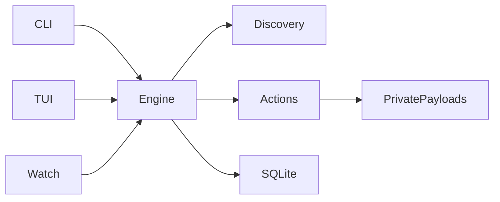

# Architecture and threat model

The single Cargo workspace exposes a reusable internal library and a thin binary.

`model` owns serialized contracts and safe display. `config` compiles declarative
rules and validates fixed safety settings. `discovery` inventories, hashes,
manifests bundles and builds bounded local references. `engine` owns policy,
preview, plans, reconciliation and per-item outcomes. `store` owns SQLite v1 and
retained snapshots/audit metadata. `paths` owns native path encoding, directory
opening and coordination. `actions` owns recoverable filesystem transactions.
`tui`, `cli`, `watch` and `service` adapt those operations.

## Paths and identity

Display strings are escaped, lossy views; they never identify a mutation target.
Native paths serialize as Unix byte hex or Windows UTF-16LE hex. Globs use relative
forward-slash components, literal separators, explicit case choice, and no
backslash escaping. Identity never lowercases or normalizes filename bytes.
Roots are canonical locations with filesystem device/inode identity on Unix.
A moved or replaced root cannot reuse the former artifact identity.

Unix regular-file reads open each absolute directory component with no-follow
directory handles, then open the last component with no-follow/nonblocking flags.
Files are bounded to 8 MiB and checked for metadata drift before/after reading.
No repository ignore file suppresses traversal. Links and reparse points create
coverage gaps rather than silently expanding scope. Proc/sys/dev are excluded
explicitly on Linux. A scan caps entries at 1,000,000, bundles at 10,000 entries /
64 MiB, and references at 16 levels / 128 per file / 64 MiB total. Larger scopes
must be split. Cycles cannot establish approval.

Windows discovery is experimental: reparse ancestors are rejected for file reads,
but native directory identity and per-user ACL qualification remain release gates.
Windows approvals and quarantine/restore are disabled. Cross-compilation is not validation.

## Trust and storage

The approval fingerprint contains root ID, relative native path, category, SHA-256,
executable bits, declarative profile revision and policy revision. Reference
fingerprints propagate to parents. Bundles use a versioned, sorted canonical
manifest of native relative paths, entry types, raw hashes, executable bits and
link targets. Links prevent a complete bundle approval. Modification time is
never an integrity shortcut. Approval is a decision record, not threat analysis.

Config and state live outside repositories through `directories::ProjectDirs`.
`--state-dir` makes a self-contained private test/portable layout with `state/`,
`data/`, `cache/` and `config.yaml`. SQLite lives in `state/rulescan.sqlite3`;
opaque quarantine payloads live in `data/quarantine/UUID/payload`. The exact
resolved paths are available through `doctor`. Unix state directories require
current ownership and mode 0700; files require 0600, no-follow and one link.
State should live on a local filesystem. Keep it outside agent skill/config roots.
No network filesystem locking or durability guarantee is implied.

SQLite uses bundled SQLite, a busy timeout, foreign keys, FULL synchronous mode,
rollback journals, and transactionally created `user_version=1` tables. Newer
versions are refused. Reconciliation writes inventory and coverage in one short
transaction after hashing. Readers use SQLite snapshots. Snapshot eviction removes
diff bytes, never current hashes or quarantine. Events retain 10,000 metadata-only
records, coverage retains 100 scans. Restores revoke old approvals.

## Coordination and transactions

Every scan, plan or file mutation takes the same per-user exclusive OS file lock.
The monitor has a separate singleton lock. Lock contention is reported rather than
allowing overlapping mutations. This initial implementation avoids an IPC broker:
the foreground process and daemon operate through the same locked engine. An IPC
transport would add no stronger same-user authorization boundary by itself.

Plans store exact observed snapshots and destination-parent identity. Apply
rehashes under the lock and refuses stale content, identities or semantics.
Overlapping bundle/file mutations require separate plans. Each batch reports
outcomes individually and cannot be replayed after application/interruption.

macOS/Linux quarantine uses native anchored, no-replace rename. Cross-volume
removal is refused. A durable prepared record precedes the move; directories are
flushed; the moved inode/manifest is rechecked; stored regular files become 0600;
then completion is recorded. Rename preserves xattrs and other native metadata.
Restore verifies the payload, records the reviewed destination, restores original
file modes and uses another no-replace rename. Unsupported metadata/entry types
remain read-only. Recovery never deletes a competing source or destination.

These are practical stale-action and recovery safeguards, not a claim of
adversarial race elimination. Open writers can still alter a moved inode. A
post-move mismatch retains the payload and requires review. Filesystem and SQLite
updates are not one atomic transaction. See the recovery state table.

## Boundaries

All scanned text and repository configuration is untrusted data. Nothing executes
Markdown, imports remote content, hooks, settings, plugins, scripts or MCP servers.
Repository-local configuration cannot grant approvals. Only the explicitly chosen
user YAML configuration controls discovery. RuleScan has no outbound network
client, model integration or telemetry. Build tools fetch dependencies separately.

A same-user process can modify config, state, approvals and scanned roots, or kill
the monitor. Unix mode bits isolate ordinary other users, not the same account.
Windows ACL verification is pending. Monitoring is detection after a change;
preflight has a check-to-read race; neither is kernel enforcement. Malicious
dependencies may already execute arbitrary code through an agent or build tool.

External process arguments are arrays, never shell interpolation. The `run` wrapper
checks before starting its child, blocks direct recursion and uses exec on Unix
to preserve terminal/signal/exit behavior. It is not a child-process sandbox.
