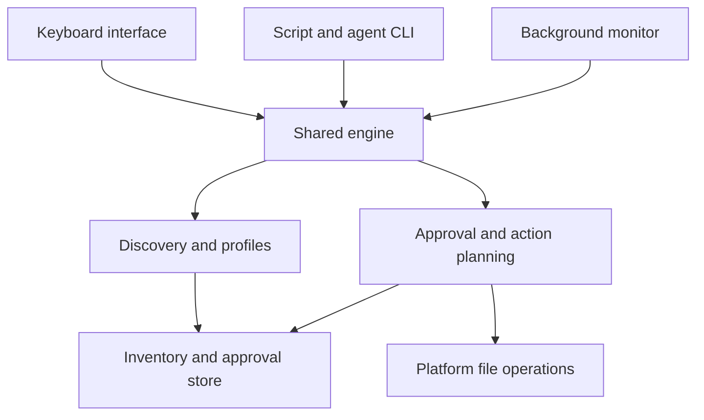

Research snapshot: 29 October 2026. Working command name: `agentguard`, used only as a placeholder; naming and package availability still need checking.

Build a local, keyboard-first CLI that finds agent instructions, skills, prompts, rules, and related configuration, then lets people inspect, approve, quarantine, restore, and monitor them. The base command must be useful without memorizing subcommands. The same engine must support noninteractive commands for coding agents, CI, editors, and scripts.

Recommended direction: Rust core, Ratatui and Crossterm interface, configurable discovery profiles, approved content baselines, recoverable quarantine, and an optional per-user background monitor. Discovery and integrity checking work offline without an account, model, or API key. Content-based threat analysis is a separate, optional capability.

Workspace trust suppresses repeat prompts for approved content; it does not stop scanning or automatically approve new instructions. A background watcher detects changes after they happen. It cannot guarantee an agent has not already consumed a file. A launch-time check can reduce exposure but also has a check-to-read race unless an integration controls subsequent reads.

This plan specifies proposed product behavior and engineering choices. Existing-project capabilities are attributed to linked primary sources. Repository-head links are research entry points; implementation must pin audited commits and compatible versions before copying code.

# Product requirements and scope

The primary user flow is: run one command, see actionable findings, navigate with familiar keys, read a safe preview or diff, approve or quarantine individual files or whole skills, and leave with a clear record of what changed.

Required capabilities:

- Run natively on macOS, Windows, and Linux.

- Discover known agent artifacts and user-defined filename, glob, and bundle rules.

- Monitor approved workspaces, global instruction locations, and selected download or extraction folders.

- Approve exact file contents and bundle manifests; flag later additions, removals, and changes.

- Quarantine and restore without silently overwriting files or losing recoverable originals.

- Offer explicit workspace exclusions and optional permissive trust separately from normal approval.

- Provide an interactive default command and a complete noninteractive interface.

- Remain extensible through versioned profiles, discovery adapters, output schemas, and a reusable engine.

- Work on SSH terminals and headless machines; notifications are supplementary.

Initial exclusions: kernel enforcement, guaranteed prompt-injection detection, malware cleanup, whole-disk privileged scanning, automatic approval by an LLM, automatic cloud uploads, and silently rewriting agent settings. A local monitor running under the same account as an unrestricted agent is not a security boundary against that agent or other same-user malware.

Success means dependable discovery, understandable decisions, low-noise monitoring, and safe recovery. “No findings” must never imply complete protection against prompt injection.

# Existing GitHub projects and reuse decisions

Use mature libraries as dependencies. Study workflow tools for interaction and operating-system integration. Do not combine several security products into a large dependency chain.

| Project and code entry point | Useful material | Proposed use and limits |
| - | - | - |
| [npkill](https://github.com/voidcosmos/npkill), README usage and source directory | Streaming discoveries, arrow and Vim navigation, filtering, selection, immediate row feedback | Borrow interaction ideas. Implement approval and recoverable quarantine semantics ourselves; Space should select, rather than delete. |
| [Ratatui table example](https://github.com/ratatui/ratatui/blob/main/ratatui-widgets/examples/table.rs) and [Ratatui](https://github.com/ratatui/ratatui) | Stateful tables, selected rows, layout and widget composition | Preferred TUI dependency. Prototype table, preview, and action queue. Use examples from the chosen release tag, since main-branch examples may require unreleased APIs. |
| [Crossterm event example](https://github.com/crossterm-rs/crossterm/blob/master/examples/event-read.rs) | Terminal events, keyboard input, resize handling | Preferred terminal backend. Add our own input contexts, key repeat handling, cleanup guards, and plain-output fallback. |
| [ripgrep walker source](https://github.com/BurntSushi/ripgrep/blob/master/crates/ignore/src/walk.rs) and [ignore crate](https://github.com/BurntSushi/ripgrep/blob/master/crates/ignore/README.md) | Recursive traversal and explicit filtering controls | Evaluate as a dependency. Disable hidden-file and repository-controlled ignore filtering for security coverage by default. Never let a repository hide its own instructions through ignore files. |
| [globset source repository](https://github.com/BurntSushi/ripgrep) and [API documentation](https://docs.rs/globset/latest/globset/) | Compiled sets of filename and path patterns | Preferred matcher. Explicitly configure separator and case behavior; do not expose platform-dependent defaults as product semantics. |
| [notify](https://github.com/notify-rs/notify) and [known problems](https://docs.rs/notify/latest/notify/) | Native filesystem events, polling, debounce companion crates | Preferred watcher. Pair events with periodic reconciliation and visible degraded coverage. |
| [Skillvet watcher](https://github.com/V3r7ig0/skillvet/blob/master/watcher/skillvet_watch.py) and repository watcher templates | Skill-bundle review, quarantine lifecycle, launchd, systemd, and Windows Scheduled Task examples | Workflow reference and targeted audit candidate. Its README documents these files; the watcher source needs a line-by-line review before reuse. Do not inherit a claim that post-write watching is a guaranteed install gate. |
| [Prismor](https://github.com/PrismorSec/prismor) and [memory integrity documentation](https://www.prismor.dev/docs/memory-integrity) | Content baselines, reapproval, change provenance | Study the state model. Keep the initial product independent of its wider runtime-control architecture. Git history is context, not proof of review. |
| [skill-scanner](https://github.com/thedevappsecguy/skill-scanner) | Multi-agent discovery conventions, reporting, optional analyzers | Compare discovery fixtures and profile coverage. Do not require its LLM or VirusTotal analysis for inventory. |
| [clap](https://github.com/clap-rs/clap) | Argument parsing, subcommands, help and completion ecosystem | Preferred CLI parser; generate help and machine-readable command metadata from a shared command model. |
| [similar](https://github.com/mitsuhiko/similar) | Text diff algorithms and unified diff generation | Preferred diff candidate; apply preview limits and escaping before rendering. |
| [rusqlite](https://github.com/rusqlite/rusqlite) | SQLite bindings with bundled SQLite support | Preferred local state candidate. Test crash recovery and migration; keep the database on a local volume. |
| [trash-rs](https://github.com/Byron/trash-rs) | OS Trash and Recycle Bin integration | Optional disposal action. Product-managed quarantine remains the recovery mechanism, rather than depending on OS Trash availability or retention. |

The first audit records, for each adopted dependency or copied snippet: exact commit or release, license and required notices, transitive dependencies, native bindings, update process, security advisories, and relevant tests. Copy only small, understood portions when a dependency is inappropriate. Preserve attribution and license obligations. An apparently similar README is not evidence that implementation is safe.

Selection gate: validate the Rust approach with a working cross-platform interaction spike before committing to the complete application. Keep the public engine independent of the TUI so the interface can change without rewriting scanning or trust logic.

# Research workstreams and decision gates

| Workstream | Questions to resolve | Experiment and required output |
| - | - | - |
| Discovery accuracy | Which files can each supported agent load, from which scopes, with which settings and imports? | Versioned coverage matrix backed by vendor documentation and fixture repositories; distinguish “found” from “known to load.” |
| Keyboard experience | Can a new user complete review quickly without learning commands? | Test a TUI prototype with 5–8 developers on all three platforms; observe finding, previewing, approving, quarantining, and restoring. |
| Filesystem identity | What happens with symlinks, junctions, casing, worktrees, renames, hard links, and removable drives? | Adversarial fixture suite and documented path-identity rules; unsafe cases stay read-only. |
| Quarantine integrity | Can every interruption be recovered without losing the only copy? | Inject failures at every transaction stage, including cross-volume copies and Windows sharing violations. Produce a recovery-state table. |
| Background operation | What coverage survives login, reboot, sleep, permissions changes, event storms, and missed events? | Native installation prototypes, coverage diagnostics, uninstall tests, and polling fallback. |
| Agent integration | Can scripts use stable results without opening a TUI or accidentally approving content? | JSON schemas, exit-code tests, stale-action protection, and a read-only agent integration example. |
| Cost and performance | How expensive are scans across large dependency trees and watchers across many directories? | Reproducible benchmark corpus, measured CPU, memory, I/O, event delay, and scan completeness. |
| Licensing and maintenance | Which components can be used under the intended project license? | Dependency inventory, licenses and notices, release pinning, and update policy. |

Implement the highest-risk spikes first: reversible quarantine, path identity, native background setup, and safe terminal rendering. A failed spike narrows the supported behavior rather than weakening safety silently.

# Keyboard first base command

Running `agentguard` in an interactive terminal opens the dashboard. It performs read-only discovery while results arrive progressively. It never automatically approves, quarantines, installs a service, or changes configuration.

On first launch, show suggested roots—current workspace, supported global agent locations, and Downloads—with a clear scope selector. Start with the current workspace and known user-level agent locations; make broader home scanning a visible choice. Save scope choices only after an explicit setup action. Later launches show the existing review queue immediately and refresh in the background.

The main screen has a findings list, preview or diff, and an action queue. Each row shows status, artifact category, agent/profile association, abbreviated path, workspace, and reason for review. A footer always shows the currently available shortcuts. The header reports scan progress, covered roots, inaccessible paths, and watcher health.

| Key | Default behavior |
| - | - |
| Up / Down or k / j | Move between rows |
| Tab / Shift Tab | Move between findings, preview, and queued actions |
| Enter | Open the selected file or bundle detail view |
| Space | Toggle selection; never delete |
| / | Search paths and names; show active query |
| f | Filter by review status, agent, category, workspace, or bundle |
| d | Toggle current contents and approved-baseline diff |
| a | Stage approval of the displayed snapshot; advance to the next unresolved item |
| x | Stage quarantine; advance to the next unresolved item |
| u | Undo the latest staged decision |
| c | Review the queued action plan |
| r | Refresh; in quarantine view, open a restore preview |
| w | Open workspace settings, with explicit trust scope |
| : | Open a searchable command palette |
| ? | Show contextual help |
| Esc | Cancel a search, close a modal, or return one level |
| q / Ctrl C | Quit; warn only if staged actions would be discarded |

In action review, Enter applies the clearly displayed plan. The UI shows exact counts, targets, content versions, and consequences. Recheck each target before applying; a file changed since preview becomes a conflict requiring a new review. Batch selection defaults to visible filtered rows only, with the scope stated explicitly.

Preserve selected row identity while new results stream in. Avoid reordering the list under the cursor. Completed decisions update in place, and failed items remain visible. Batch actions report per-item outcomes rather than pretending the entire batch was atomic.

Usability targets for testing: first useful results within 2 seconds on the reference fixture; a single decision can be staged with one key; multiple decisions share one concise review step; restore is discoverable without reading documentation. These are proposed acceptance targets, not measured performance claims.

Support 80-column terminals, narrow-screen stacked views, no-color/high-contrast modes, configurable keys, and a linear `--plain` review flow for accessibility. Use text labels as well as color. Filter out release/repeat key events where appropriate so holding a key cannot stage repeated actions. Restore terminal state after normal exit, cancellation, or panic.

Treat file contents and filenames as hostile display data: escape terminal control sequences, OSC commands, embedded newlines in paths, and invisible/bidirectional characters. Do not execute Markdown, activate remote images, follow links automatically, or run a repository-defined pager or editor. External opening is an explicit user action through a configured executable and argument array.

# Discovery profiles and skill bundles

Discovery has two outputs: candidate artifacts anywhere under configured roots, and agent-specific explanations of whether those artifacts are likely to load in a particular workspace. Do not equate a filename match with proof that an agent uses the file.

| Profile | Initial candidate coverage | Important behavior |
| - | - | - |
| Shared and Codex instructions | AGENTS.md, AGENTS.override.md, configured fallback filenames, supported global locations | Adapter resolves the installed agent version and configured scope when available; generic discovery still works without the agent installed. |
| Claude instructions and rules | CLAUDE.md, CLAUDE.local.md, .claude/CLAUDE.md, supported AGENTS.md behavior, .claude/rules Markdown, local/global settings references | Resolve supported imports with bounded recursion; record why each reference was followed. |
| Skills | SKILL.md under known and custom roots, plus each discovered skill directory | Treat its manifest, scripts, resources, links, and configuration as a bundle. |
| Copilot customization | .github/copilot-instructions.md, .github/instructions/\*\*/\*.instructions.md, supported agent and prompt files | Record feature-specific loading differences instead of assuming all Copilot clients behave identically. |
| Gemini | GEMINI.md, configured context filenames, supported global and extension paths | Read documented context configuration and import rules through a bounded adapter. |
| Cursor and other rules | .cursor/rules/\*\*/\*.mdc, .cursorrules, additional opt-in agent profiles | Keep mappings versioned and source-backed. |
| Hooks and configuration | Known agent settings, hook manifests, MCP configuration references | Inspect as data only. Never execute hooks or start MCP servers during discovery. Shared settings files require special review before whole-file quarantine. |
| Custom rules | Exact basenames, relative-path globs, directory bundles | Arbitrary patterns work without an agent-specific adapter. Category labels do not grant execution or trust. |

Primary convention references: [Claude memory and instruction documentation](https://code.claude.com/docs/en/memory), [Gemini context files](https://geminicli.com/docs/cli/gemini-md/), and [GitHub repository instructions](https://docs.github.com/en/copilot/how-tos/copilot-on-github/customize-copilot/add-custom-instructions/add-repository-instructions). Publish an explicit tested-version matrix with profile updates.

For each skill, build a stable manifest of relative path, entry type, content hash, relevant executable-mode bits, and symbolic-link target where applicable. A new script changes approval even when SKILL.md is unchanged. Set bounded entry and byte budgets; exceeding them yields an incomplete bundle requiring review, never a clean verdict. Do not silently prune scripts or resources from approval.

Keep imported files as separately identified graph nodes linked to their parent artifact. Detect cycles, cap depth and total bytes, and flag references outside scan roots. Do not fetch remote imports automatically. A shared imported file can affect multiple approved instructions and should invalidate dependent approvals.

Hidden paths and dependency directories are included by default. Repository .gitignore, .ignore, or tool-specific ignore files must not suppress discovery unless the user explicitly enables that behavior. Exclude the tool's own private state and quarantine from scanning. Skip virtual filesystems and inaccessible locations with an explicit coverage record. Never silently claim an entire disk was scanned.

# Trust model and decision state

Maintain separate fields for discovery category, approval state, optional content-analysis findings, and scan coverage. A file can be approved, have a new heuristic warning, and belong to a partially scanned root; these are different facts.

Approval identity includes a stable workspace identifier, relative native path, artifact type, hash algorithm and digest, bundle manifest digest where relevant, profile/adapter version, policy version, approval time, and recorded decision source. SHA-256 is the proposed initial content hash. Hash raw bytes; do not normalize line endings or Unicode before integrity comparison.

| State or policy | Meaning | Default behavior |
| - | - | - |
| New | Matching artifact with no approved baseline | Review |
| Approved | Current bytes or bundle manifest match the approved snapshot | Quiet; continue monitoring |
| Changed | Existing approval no longer matches | Review with a diff |
| Missing | Previously tracked artifact no longer exists | Record removal; invalidate dependent bundle approval |
| Quarantined | Recoverable payload removed from its active location | Show in quarantine view |
| Excluded | User explicitly removed location from coverage | Do not scan; display coverage exclusion |
| Unreadable or unstable | Permission failure, changing bytes, unsupported entry, or exceeded budget | Show incomplete coverage; no approval |
| Permissive workspace | User explicitly accepts new content under a constrained scope | Suppress normal review according to policy; visibly mark weaker protection |

Workspace approval registers a root and its approved snapshots. It does not approve an unlimited future subtree. Nested repositories and newly created worktrees require their own recorded scope decision; moving a repository does not silently transfer trust by matching its remote URL. Repository origin and signed commits can provide context but never substitute for approval.

Track file-system identity and location separately. A symlink or Windows junction cannot borrow trust from its textual location. Default to inventorying links without traversing directory targets; if users enable following, disclose the resolved target and require trust for it. Refuse automatic mutation of unresolved link/reparse-point cases.

Store approvals and executable policy outside scanned repositories. Repository-local configuration may propose additional discovery patterns but cannot grant trust, weaken global exclusions, run plugins, or establish automatic approvals. Display proposed configuration before adopting it.

There is no automatic first-use trust. The first scan is an inventory for review. Users may approve a selected baseline in one batch after inspecting the scope and snapshots. An agent calling a mutating CLI command is not cryptographic evidence that a human reviewed it. Same-account users and processes may still tamper with local state; stronger separation would require an additional privileged broker or isolated execution model.

Rehash approved candidates during scheduled integrity reconciliation and preflight checks. Size and modification time may optimize routine event processing, but unchanged metadata alone cannot establish integrity.

# Configuration and pattern semantics

Use one documented, versioned configuration format. Proposed default: YAML with JSON Schema, duplicate-key rejection, bounded parsing, unknown-field errors, and a deterministic merge model. The syntax below is a proposed product contract, not an existing executable interface.

```yaml
version: 1

scan:
  roots:
    - "~/Projects"
    - "~/Downloads"
  include_hidden: true
  respect_repository_ignores: false
  follow_directory_links: false

profiles:
  shared_instructions: true
  claude: true
  codex: true
  copilot: true
  gemini: true
  skills: true
  hooks: true

rules:
  - id: team-guide
    match:
      basename: "TEAM_GUIDE.md"
      case: insensitive
    category: instructions
    on_new: review
    on_change: review

  - id: custom-agent-directory
    match:
      glob: "**/.my-agent/**"
      case: sensitive
    category: agent_configuration
    on_new: review
    on_change: review

  - id: company-skills
    match:
      bundle_marker: "SKILL.md"
    category: skill
    on_new: review
    on_change: review

workspaces:
  - path: "~/Projects/reactive-resume"
    policy: approved_content

exclusions:
  - path: "~/Projects/disposable-fixtures"
    reason: "Deliberately malicious test fixtures"

watch:
  enabled: false
  debounce: "500ms"
  reconcile_every: "6h"
  default_action: notify

analysis:
  enabled: false

ui:
  color: auto
  keymap: default
```

A basename matches that name at any depth. A glob matches paths relative to each declared root using forward-slash separators on every OS. Configure globset with literal separators and an explicit escape policy so backslashes do not acquire platform-dependent meanings. Quote globs in shell examples. A pattern ending in /\*\* identifies descendants; bundle membership is a separate explicit rule.

Matching and identity use different representations: portable relative paths for patterns, native lossless paths and verified handles for operations. Do not globally lowercase paths. Discovery may deliberately match known filenames case-insensitively, while approval identity respects the actual filesystem and file identity.

Configuration precedence: built-in defaults, approved user configuration, approved workspace additions, explicit invocation options. Workspace additions can widen discovery but cannot lower review requirements. When action rules overlap, choose review over notify and require explicit policy for automatic quarantine; do not let rule order accidentally weaken protection. Exclusions are a separate, visible coverage decision. Provide an explain command that lists every matching rule and the final outcome.

Provide configuration validation, migration previews, effective-config output with secret redaction, a pattern-test command, and an interactive settings screen. Profile updates are versioned data changes and require an explicit update step; no silent remote rule execution.

[globset documents configurable separator and case behavior](https://docs.rs/globset/latest/globset/); the product must set these options deliberately and verify them against a cross-platform fixture matrix.

# Engine architecture and persistent state

Use one Cargo workspace with modules or crates for core models, discovery, profiles, policy, storage, filesystem operations, platform integration, CLI, and TUI. Begin with internal module boundaries; publish a reusable engine crate only after its API stabilizes.



The engine exposes scan, inspect, explain, plan, approve, quarantine, restore, and verify operations independently of rendering. No UI code touches files directly. Worker tasks emit bounded progress events; the TUI consumes snapshots without blocking input. Use bounded queues and cancellation propagation so an event flood cannot exhaust memory.

SQLite stores inventory and decisions; payload snapshots and quarantine blobs live in a private local data directory. Bundle hashes use an explicitly versioned canonical manifest representation and lossless path encoding. Keep content hashing and bundle hashing distinct.

Proposed tables:

| Entity | Key information |
| - | - |
| roots | Root identity, native path, filesystem/volume identity, coverage and last completed scan |
| artifacts | Stable ID, category, native path encoding, observed digest, size, profile version, bundle association |
| references | Parent artifact, imported or supporting artifact, resolution reason and scope |
| approvals | Artifact/manifest digest, policy version, time, source and revocation |
| scans | Started/completed timestamps, cursor/checkpoint, partial errors and coverage |
| actions | Action ID, expected snapshot, durable stage, per-target outcome |
| quarantine | Original path and identity, stored payload manifest, metadata, restore state |
| events | Bounded audit history of observations and decisions |
| policies | Approved configuration revisions and profile versions |

Diffs require approved content snapshots, not just hashes. Store bounded snapshots privately and disclose retention; avoid putting raw content in logs. Expired snapshots may remove historical diff ability but must not remove the current approved hash or an active quarantine payload.

Use explicit local locations, with environment-aware resolution rather than string concatenation:

| Purpose | macOS | Windows | Linux |
| - | - | - | - |
| User configuration | \~/Library/Application Support/agentguard/config.yaml | %LOCALAPPDATA%/AgentGuard/config.yaml | $XDG_CONFIG_HOME/agentguard/config.yaml, default \~/.config/agentguard/config.yaml |
| Database and approvals | \~/Library/Application Support/agentguard/state/ | %LOCALAPPDATA%/AgentGuard/state/ | $XDG_STATE_HOME/agentguard/, default \~/.local/state/agentguard/ |
| Snapshots and quarantine | \~/Library/Application Support/agentguard/data/ | %LOCALAPPDATA%/AgentGuard/data/ | $XDG_DATA_HOME/agentguard/, default \~/.local/share/agentguard/ |
| Runtime IPC | Private owner-only directory under the user runtime/temp location | User-SID-scoped named pipe | $XDG_RUNTIME_DIR/agentguard/, with a private validated fallback |
| Cache | \~/Library/Caches/agentguard/ | %LOCALAPPDATA%/AgentGuard/cache/ | $XDG_CACHE_HOME/agentguard/, default \~/.cache/agentguard/ |

Cache may be deleted without losing approvals or quarantine. Temporary/runtime paths must be securely created and ownership-checked. Do not use roaming Windows state for live SQLite or quarantine. [ProjectDirs documents platform-specific directory mapping](https://docs.rs/directories/latest/directories/struct.ProjectDirs.html); validate the actual resolved locations in doctor.

Use bundled SQLite for predictable deployment, subject to size and licensing checks. [Rusqlite documents its bundled SQLite option](https://github.com/rusqlite/rusqlite). Enable foreign keys, short transactions, a busy timeout, versioned migrations, and crash tests. Keep the database on local storage even when scanning a network volume.

When the daemon runs, it owns mutation coordination over a restricted local IPC endpoint. Without it, a CLI invocation takes the same per-user coordination lock and operates directly. Readers may inspect consistent SQLite snapshots. Never allow two actors to perform overlapping quarantine or restore operations. Unix sockets live in a private runtime directory; Windows named pipes must be scoped to the user's SID and deny remote access. These controls separate users, not humans from agents under the same account.

# Quarantine and restore transaction design

Product-managed quarantine is a recoverable file operation, not a rename to AGENTS.md.disabled in the same directory. Store payloads outside active agent roots using opaque object names and a manifest. Remove execute permissions from stored regular files where supported; do not preserve active skill layouts in a directory an agent scans. Protect the quarantine directory with owner-only permissions or an appropriate Windows ACL.

Default behavior is notification and review. Users can explicitly opt particular untrusted roots into automatic quarantine. Never auto-quarantine shared settings files, an entire workspace, a link target, or a directory merely because its name matches a broad rule.

Each action follows a durable state machine:

1. Build a plan against an exact observed snapshot. Show whether the unit is a file or whole skill, the original location, expected digest, linked dependencies, and any unsupported metadata.

2. Acquire the coordination lock. Reopen and verify path identity, entry type, scope, and contents using platform-aware operations. If anything drifted, stop that item with a conflict.

3. Persist a prepared action record before removing content from its active location.

4. Prefer a verified same-volume move into a private staging location when available. For cross-volume actions, copy into staging without following links, flush data, and verify content and required metadata before considering removal.

5. Revalidate the source before removal. A concurrent modification prevents deletion; leave a recoverable staged copy and report the conflict.

6. Finalize the quarantine manifest and durable completion record. Report per-item results and retain the mapping to original paths.

7. On restart, reconcile incomplete records and staging contents before accepting new mutations.

Filesystem and database changes cannot be one atomic transaction. Test every interruption boundary. Do not claim adversarial race resistance from a hash-then-rename sequence alone: handle-based identity checks and no-follow primitives need platform-specific validation. Unsupported cases stay review-only.

Cross-volume skill moves are especially risky because a bundle may change while copying. The first release may restrict bundle quarantine to verified same-volume moves and offer manual guidance for other cases. Release cross-volume removal only after failure-injection and concurrent-writer tests prove recovery behavior.

Metadata policy must address Unix permissions, links, timestamps, extended attributes, Windows ACLs and alternate data streams. The initial implementation either preserves the required data or refuses the mutation with a precise reason. Do not silently discard unsupported streams or metadata.

Restore always previews the destination and verifies the quarantine payload. If a destination exists, offer restore to a new location or a separately reviewed replace operation; never overwrite silently. Restoration invalidates stale approvals unless the restored object still matches the approved identity and policy. “Undo” after a completed action is a restore transaction, not an assumed reversal.

Permanent deletion is a distinct, deliberate command with an exact target summary. No automatic purge of quarantine in the initial release. OS Trash can be an additional explicit disposal option; [trash-rs](https://github.com/Byron/trash-rs) is a library candidate, not the primary recovery store.

# Background monitor and all three platforms

Use a per-user background process. It does not need root or administrator access for its normal scope. “Installed” means startup integration exists; “running” means the process responds; “healthy” additionally means configured roots have known coverage. Report these separately.

The monitor watches directory changes, coalesces bursts, rescans affected paths, and periodically performs full reconciliation. Watch parent directories for root replacement or deletion. On startup and after a detected coverage gap, reconcile before declaring coverage current. Notifications are deduplicated by artifact and digest; repeated saves update one finding.

[Notify documents missing events on some network filesystems, WSL cross-filesystem limitations, editor replacement behavior, and watch-resource limits](https://docs.rs/notify/latest/notify/). Treat events as hints to rescan. Provide explicit polling per root and visible fallback status. Avoid a permanent recursive watch on the entire home directory by default; make its resource cost visible when enabled.

Proposed starting values: 500 ms debounce with a maximum delay to prevent event storms starving scans; 6-hour full reconciliation plus immediate reconciliation at startup; jitter between roots; bounded hashing workers; no waking sleeping laptops. Tune these values from benchmark results.

| Area | macOS | Windows | Linux |
| - | - | - | - |
| Startup | Per-user LaunchAgent | Per-user Scheduled Task at logon | systemd user service |
| Initial architecture | Apple Silicon and Intel native builds | x64 native build; ARM64 release after native validation | x86_64 and ARM64 builds |
| Local watcher | Notify native macOS backend; polling when necessary | Notify native Windows backend; polling where events are unreliable | Notify inotify backend; explicit polling fallback |
| Local coordination | User-owned Unix socket | Named pipe restricted to user SID | User-owned Unix socket under user runtime directory |
| Private state | Application Support directory | LocalAppData, not a roaming database | XDG state/data directories |
| Notifications | Optional native helper or supported user-session integration | Optional user-session notification integration | Optional desktop-session notification integration |
| Headless behavior | Queue and CLI status | Queue and CLI status | Queue and CLI status |
| Installation privilege | Current user | Current user | Current user |

## macOS implementation

Install a labeled plist under \~/Library/LaunchAgents with an absolute executable path and argument array. Use RunAtLoad, restart policy with throttling, a fixed working directory, and bounded log files. Manage it through launchctl; do not depend on interactive-shell PATH. Validate installation, unloading, upgrades, and removal in a fresh user session.

Apple distinguishes user agents from system daemons; per-user LaunchAgents run in the logged-in user's context. [Apple startup guidance](https://developer.apple.com/library/archive/documentation/MacOSX/Conceptual/BPSystemStartup/Chapters/CreatingLaunchdJobs.html) and [current launchd guidance](https://support.apple.com/guide/terminal/script-management-with-launchd-apdc6c1077b-5d5d-4d35-9c19-60f2397b2369/2.15/mac) are the implementation references.

Protected folders such as Downloads and Documents may require macOS privacy authorization. [Apple documents file and folder access controls](https://support.apple.com/en-gb/guide/mac-help/mchld5a35146/mac). Validate the signed binary both from Terminal and as a LaunchAgent; do not assume Terminal's authorization transfers to background execution. Permission denial must produce a coverage gap, not an empty clean scan.

Keep a stable executable identity across updates. Evaluate signing/notarization and any small notification or permission helper during the native spike. A bundled app using Service Management is a possible later packaging route; do not assume app-bundle APIs are directly interchangeable with a standalone CLI installer.

Choose the oldest supported macOS release after compiling and running the actual dependency set. Test the latest stable release and that declared minimum on native machines before publishing support.

## Windows implementation

Register a current-user logon-triggered task with an absolute executable path, separate arguments, working directory, restart policy, and explicit single-instance behavior. Do not request elevated privileges or store user passwords. Use Task Scheduler APIs or safely generated XML with separately encoded fields; avoid shell string concatenation.

[Microsoft documents logon-triggered executable tasks](https://learn.microsoft.com/en-us/windows/win32/taskschd/starting-an-executable-when-a-user-logs-on). Set task runtime and battery behavior explicitly: the [TaskSettings reference](https://learn.microsoft.com/windows/win32/taskschd/tasksettings) documents both and notes the default runtime limit. Ensure the long-running watcher is not terminated merely because a default timeout was inherited. Make battery policy visible and configurable.

Use Windows-native paths and wide-character APIs where necessary. Test long paths, UNC roots, inaccessible shares, locked files, antivirus interference, OneDrive placeholders, case-sensitive directories, and reparse points. [Reparse points can represent filesystem links and mounted folders](https://learn.microsoft.com/en-us/windows/win32/fileio/reparse-points); inspect their type instead of assuming every directory is ordinary.

The initial supported desktop target is Windows 11 x64. Test ARM64 natively before marking it supported; older Windows versions are not promised solely because the program compiles. Treat WSL as a separate Linux execution environment. Do not assume a Windows watcher covers Linux-distribution paths or vice versa.

A real Windows Service is a later enterprise option with a separate user-session helper. Keep the initial design per-user so review, credentials, notifications, and file access stay in the expected account context.

## Linux implementation

Install a user unit under the user's systemd configuration directory with an absolute ExecStart, restart-on-failure, a bounded restart policy, and logs accessible through the journal. Use systemctl --user for lifecycle management. Do not automatically enable lingering or modify system limits.

[Systemd service documentation](https://www.freedesktop.org/software/systemd/man/latest/systemd.service.html) defines supervision behavior. The running daemon owns its reconciliation timer. An optional periodic-only mode uses a separate oneshot service and calendar timer; [Persistent applies to calendar timers, not arbitrary monotonic intervals](https://www.freedesktop.org/software/systemd/man/256/systemd.timer.html).

If no user systemd manager is available, support foreground watch mode and explicit periodic scan scheduling. Explain the limitation through doctor rather than installing a different supervisor silently. Notifications are optional and must not make headless scans fail.

Test watch-limit exhaustion with a nonprivileged fallback, bind mounts, permissions, removable roots, network volumes, native non-UTF-8 filenames, and sleep/resume. Initial distribution validation should include one supported Ubuntu LTS and one current mainstream distribution. Validate a musl build separately before describing it as generally portable.

# User facing service management and diagnostics

The same commands work on every OS:

```text
agentguard service install
agentguard service start
agentguard service stop
agentguard service status
agentguard service logs
agentguard service uninstall
agentguard doctor
```

Installation is explicitly requested; the base command never installs startup integration. Show the generated native integration and scope in a concise preview. Do not alter unrelated login items or services.

Status includes executable version/path, integration type, user identity, running state, last complete reconciliation, watched roots, polling fallbacks, permission failures, queue size, and last error. Doctor checks database health, IPC permissions, configuration validity, available watcher coverage, executable relocation, and integration compatibility. Diagnostics redact content and secrets.

Upgrades stop or coordinate with the old daemon, preserve approvals and quarantine, migrate state transactionally, update the absolute startup path if required, and verify health before reporting success. Uninstall removes only the installed integration and executable under management; keep approvals and quarantine unless the user separately chooses data removal.

# Agent ready command and data contracts

Agent readiness is a first-class requirement: every core operation is available without simulating keystrokes. Interactive and machine commands use the same models, action planning, identity checks, and policy evaluation.

Proposed commands:

```text
agentguard
agentguard scan --root PATH --format json --no-input
agentguard findings list --status new,changed --format json
agentguard inspect ARTIFACT_ID --format json
agentguard explain ARTIFACT_ID --format json
agentguard verify --workspace PATH --format json
agentguard plan approve --id ARTIFACT_ID --expected-sha256 DIGEST
agentguard plan quarantine --id ARTIFACT_ID --expected-sha256 DIGEST
agentguard apply PLAN_ID --no-input
agentguard quarantine list --format json
agentguard restore QUARANTINE_ID --to PATH --no-input
agentguard config validate
agentguard patterns test --path RELATIVE_PATH
agentguard schema
agentguard watch --foreground
agentguard check --workspace PATH --no-input
agentguard run --workspace PATH -- EXECUTABLE ARGUMENTS
```

Noninteractive mutations require an explicit action plan or a scoped, previously configured automation policy. Never infer approval from --no-input, a successful scan, or a model's recommendation. Expose read-only operations by default in agent integrations. A same-user CLI cannot reliably determine whether its caller is a human or an agent; do not claim flags or a TTY check enforce that distinction.

Each JSON response carries schema_version, request_id, operation, completion status, scope/coverage, policy/profile versions, and structured data or errors. Findings include artifact_id, display path, lossless native path representation when needed, category, observed digest, approval state, matching rule IDs, reasons, and allowed next actions. Raw file content is omitted unless explicitly requested; when returned, label it untrusted data.

Use stdout only for selected machine output; progress and diagnostics go to stderr. Support JSON for snapshots and JSONL for events, with stable event kinds and sequence cursors. Piped input/output never opens the TUI, prompts, or emits terminal escapes. With no subcommand in a noninteractive environment, return a read-only summary and guidance; do not begin an unexpected home scan.

For scanner/check operations, propose exit codes: 0 completed with no findings that violate the selected policy; 1 completed with actionable policy findings; 2 invocation or configuration error; 3 incomplete coverage; 4 stale action or conflict; 5 operational failure; 130 interrupted. If findings and coverage gaps coexist, incomplete coverage takes precedence. Mutating commands use 0 only when the requested operation completed and include per-item outcomes; unresolved errors are nonzero.

The run wrapper checks applicable instructions before starting a child process and passes arguments without a shell. It must preserve signals, interactive terminal behavior, working directory, and child exit status, and must not recurse into its own executable. A documented wrapper-specific error identifies preflight failure. This reduces accidental exposure; it does not freeze files, constrain an already running agent, or eliminate read races.

Publish JSON Schemas, a concise command reference, examples for agents, shell completions, and an integration guide. A later local MCP adapter can expose scan, list, inspect, explain, and verify as read-only tools. Mutation exposure stays separately opt-in, with the same action plans and explicit same-user limitations. No MCP dependency is needed for the first release.

# Extensibility and optional analysis

Use a small set of internal extension boundaries: DiscoveryProvider emits candidates and references; Matcher compiles rules; Analyzer emits advisory findings; PolicyEngine computes required review; ActionBackend performs verified file operations; PlatformService manages startup; EventSink handles output and notification.

Built-in profiles are declarative manifests with IDs, versions, filename/glob patterns, known root locators, bundle rules, documented agent versions, source links, and fixture tests. User rules extend them without rebuilding the binary. Complex import resolution belongs in a reviewed adapter, not arbitrary executable configuration.

Future profile updates may add new observations but must never silently approve content, broaden mutation privileges, or execute code. Validate updates, show a coverage diff, support rollback, and retain the profile version used by each approval. A new adapter or changed bundle semantics can require reapproval even when individual bytes are unchanged.

Start with local deterministic discovery and hashing. Add local heuristic analysis only as advisory findings with rule IDs, evidence ranges, and explanations. Filename matching indicates possible relevance; a content score does not establish safety. Pattern and analysis rules have separate namespaces and release lifecycles.

Optional LLM analysis must be explicitly enabled with a chosen provider and disclosed data flow. The scanned text cannot issue tool calls, modify policy, or approve itself through the analyzer. Local models or hosted providers can be adapters later; the default application has no model dependency.

Defer arbitrary executable plugins until a concrete integration requires them. If introduced, use a versioned subprocess protocol with timeouts, output limits, declared capabilities, and explicit installation. Do not describe a subprocess or WebAssembly runtime alone as an adequate sandbox. Protect the core approval and quarantine operations from plugin-defined implementations.

The product should be easy to use without configuration, agent ready without a terminal UI, and extensible without rewriting its core. These three properties are acceptance criteria for each release, rather than documentation slogans.

# Validation matrix and acceptance criteria

These are implementation and research tasks, not checks already performed on a built product. Cross-platform support is earned by native execution, not cross-compilation alone.

| Test family | Required scenarios | Passing condition |
| - | - | - |
| Discovery | Root/nested/global instructions, custom names, hidden paths, ignored dependencies, worktrees, bundles, imports and cycles | Every expected candidate is found; loading explanations remain distinct from candidate discovery |
| Trust | Changed bytes with preserved size/time, new skill scripts, removed resources, changed executable bits, moved roots and profile changes | No stale approval is accepted |
| Display safety | ESC/OSC sequences, bidirectional text, newline-containing paths, long lines, binary data and malformed encodings | No terminal side effects; escaped content remains inspectable |
| File operations | Missing source, permission denial, locked file, full disk, cross-volume copy, metadata mismatch, concurrent editor save | Never lose the only recoverable copy or overwrite an unreviewed destination |
| Crash recovery | Terminate after each durable action stage and during database migration | Recovery identifies the actual filesystem state and exposes incomplete operations |
| Path boundaries | Symlinks, hard links, junctions, reparse points, case differences, replaced ancestor/root and link loops | No trust escape or unsupported automatic mutation |
| Watch reliability | Atomic-save editors, event storms, overflow, root deletion/recreation, sleep/resume, unavailable network share | Reconciliation restores inventory or exposes a coverage gap |
| Native startup | Install/start/stop/reboot/login/logout/upgrade/uninstall as an ordinary user | Correct user identity and scope; no unrelated OS configuration changed |
| CLI contract | Piped execution, JSON/JSONL, invalid config, cancellation, stale plan, partial scan | Stable schemas, correct exit codes, no accidental prompts |
| UI | Small terminal, resize, large list, staged batches, filtering, key repeat, errors and restore | Responsive navigation, stable selection, visible consequences and recovery |
| Privacy | Diagnostic exports, stored snapshots, logs, external analyzer disabled | No raw secrets in logs or unintended network transfer |

Build fixture repositories containing harmless simulated attacks: instruction files deposited in Downloads, dependency-created instructions, altered skill scripts, outside-root imports, malicious filenames, and instructions telling the scanner to approve or delete files. Fixtures must never actually exfiltrate data or execute payloads.

Add property tests for glob semantics, lossless path serialization, bundle-manifest stability, and action-state transitions. Add parser and preview fuzzing with strict memory/time limits. Use temporary filesystems and failure injection for mutation tests; mock-only tests cannot validate OS behavior.

Proposed benchmark corpus: 100,000 entries with 1,000 candidate artifacts; a 1-million-entry dependency-heavy tree; 10,000 findings for TUI responsiveness; and controlled event bursts. Record hardware, OS, filesystem, cache state, permissions, and supported feature set.

Initial performance targets: UI input response below 100 ms at the 95th percentile during background scanning; first useful results within 2 seconds on the reference corpus; local normal-load changes surfaced within 2 seconds after debounce; idle monitor CPU under 1 percent on the reference system, memory under 100 MB, and no continuous whole-tree polling where native events work. Record actual results and adjust targets before public promises. Event delay is a responsiveness measure, not a prevention guarantee.

CI runs build, formatting, linting, core integration tests, TUI event/state tests, and native filesystem tests on macOS, Windows, and Linux. Use a native ARM runner or actual machine for ARM support. Test signed/notarized or installed artifacts separately from development binaries. Keep manual permission and login-session tests as explicit release checks where CI cannot reproduce the environment.

# Delivery milestones and research outputs

| Milestone | Deliverable | Exit gate |
| - | - | - |
| 0 Research and architecture spikes | Source-backed discovery matrix, reuse/license inventory, keyboard prototype, path and quarantine spikes, startup prototypes | Demonstrate core flow natively on all three OS families; document unsupported cases |
| 1 Read-only foundation | Shared engine, profiles, custom pattern config, streaming scan, JSON output, coverage reporting and doctor | Discovery fixtures, cross-platform pattern tests, and noninteractive contracts pass |
| 2 First useful interactive release | Base-command dashboard, preview/diff, staged actions, approved baselines, verified quarantine and restore | Usability tasks completed by new users; crash recovery and native mutation tests pass |
| 3 Background monitoring | Service lifecycle commands, event watching, reconciliation, queue, optional notifications and health status | Login/restart/sleep tests and missed-event recovery pass on all three platforms |
| 4 Agent integration | Stable command schema, check/run wrapper, optional read-only MCP bridge, integration examples | Scripts complete full flows without a TTY; stale snapshots and policy errors handled correctly |
| 5 Extensible public release | Versioned profiles, migration and update process, reproducible packages, signed release artifacts, contributor documentation | Published compatibility/coverage matrix and completed release checklist |

JSON output and headless operation start in milestone 1; they are not postponed until the agent-integration milestone. Custom filename and glob rules also belong in the foundation.

Suggested early release boundary: ship discovery, review, approved-content monitoring, and well-tested recoverable file operations first. Delay automatic quarantine, unsupported cross-volume bundle moves, executable plugins, and semantic threat scores until their research gates pass.

Required repository documents:

- Product specification with the base-command interaction contract and key map.

- Architecture decisions for runtime, paths, trust, quarantine, storage, IPC, and extension APIs.

- Discovery coverage matrix with vendor links, tested versions, candidate rules and loading semantics.

- Threat model distinguishing detection, preflight checks, actual enforcement, and same-user limitations.

- Configuration and output schemas with compatibility policy.

- Dependency/code reuse inventory with pinned revisions and license notices.

- Native packaging and service installation specifications.

- Recovery runbook and failure-injection test plan.

- Benchmark harness and reference results.

- Contributor guide for adding a profile, adapter, analyzer, and platform test.

Use milestone exit gates to estimate effort after the native spikes. Do not assign a confident delivery date before validating filesystem recovery and macOS background permissions.

# Open decisions and how to settle them

| Decision | Recommended default | Evidence needed before expanding |
| - | - | - |
| Rust versus another runtime | Rust with a TUI-independent core | Three-OS prototype covering packaged startup, event handling, file identity, and recovery |
| Workspace policy | Approved content only | User testing before adding broader trust shortcuts |
| First launch scan scope | Current workspace plus disclosed user-agent roots | Measure noise and cost before enabling home-wide scanning by default |
| Mutation unit | Individual instruction or explicit skill bundle | Review shared references; avoid automatically moving shared configuration |
| Cross-volume bundle quarantine | Review-only until validated | Failure-injection and concurrent-writer proof of recovery |
| Automatic quarantine | Off | Demonstrated false-positive rate, clear per-root policy and complete recovery |
| Historical snapshots | Private, bounded, documented retention | Storage measurements and privacy review |
| Notifications | Optional; queue is authoritative | Native notification packaging and permission tests |
| Windows ARM and older OS support | Only mark tested native targets supported | Native release-artifact test results |
| Runtime plugins | Defer | A concrete integration that declarative profiles or compiled adapters cannot support |
| Content analysis | Optional advisory layer | Evaluation corpus, precision/recall measurements, and explicit data handling |

The largest product risk is alert fatigue. Group related files into bundles, deduplicate repeat observations, explain why a file matters, keep approved unchanged content quiet, and let users choose scan scope. The largest implementation risk is unsafe remediation. Prefer an incomplete but truthful result over a destructive action whose identity or recoverability is uncertain.

The distinction to preserve in product messaging is straightforward: the tool helps people control local instructions and detect unexpected changes. It does not prove instructions are benign or constrain every agent action. A malicious dependency may already have code execution, as the [NVIDIA research explains](https://developer.nvidia.com/blog/mitigating-indirect-agents-md-injection-attacks-in-agentic-environments/). The [Aviatrix incident analysis](https://aviatrix.ai/threat-research-center/in-the-wild-attack-ai-agents-trust-markdown/) motivates examining ambient download locations as well as repositories.

# Primary references

The GitHub reuse table links directly to candidate projects and relevant code. Additional implementation references:

- [NVIDIA indirect AGENTS.md injection research](https://developer.nvidia.com/blog/mitigating-indirect-agents-md-injection-attacks-in-agentic-environments/)

- [Aviatrix instruction-file incident analysis](https://aviatrix.ai/threat-research-center/in-the-wild-attack-ai-agents-trust-markdown/)

- [Claude instruction loading and imports](https://code.claude.com/docs/en/memory)

- [Gemini CLI context files](https://geminicli.com/docs/cli/gemini-md/)

- [GitHub Copilot repository instructions](https://docs.github.com/en/copilot/how-tos/copilot-on-github/customize-copilot/add-custom-instructions/add-repository-instructions)

- [Notify API and filesystem caveats](https://docs.rs/notify/latest/notify/)

- [Globset syntax and configuration](https://docs.rs/globset/latest/globset/)

- [ProjectDirs platform directory mapping](https://docs.rs/directories/latest/directories/struct.ProjectDirs.html)

- [Apple LaunchAgents and launchd](https://developer.apple.com/library/archive/documentation/MacOSX/Conceptual/BPSystemStartup/Chapters/CreatingLaunchdJobs.html)

- [Apple Service Management](https://developer.apple.com/documentation/servicemanagement/)

- [Apple Files and Folders permissions](https://support.apple.com/en-gb/guide/mac-help/mchld5a35146/mac)

- [Microsoft Task Scheduler logon execution](https://learn.microsoft.com/en-us/windows/win32/taskschd/starting-an-executable-when-a-user-logs-on)

- [Microsoft TaskSettings](https://learn.microsoft.com/windows/win32/taskschd/tasksettings)

- [Microsoft reparse points](https://learn.microsoft.com/en-us/windows/win32/fileio/reparse-points)

- [Systemd service units](https://www.freedesktop.org/software/systemd/man/latest/systemd.service.html)

- [Systemd timer semantics](https://www.freedesktop.org/software/systemd/man/256/systemd.timer.html)

Repository links are intentionally source entry points rather than a claim that every linked implementation was audited. Pin exact commits, inspect source and licenses, and execute the native experiments before selecting code for production.
